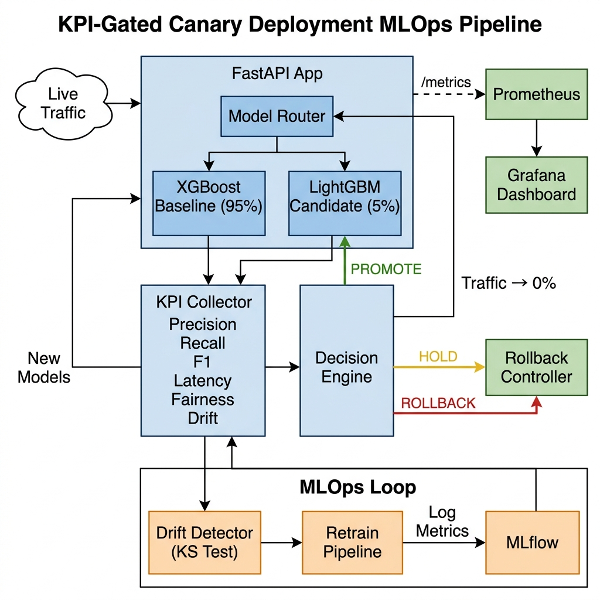

# KPI-Gated Progressive Delivery for ML Model Deployment

> An end-to-end MLOps pipeline implementing automated canary releases with statistical KPI gates, drift detection, and closed-loop retraining.


**Authors:** Abdullah, Abdur Rahman Grami, Yousha Saibi
**Department of Data Science — FAST NUCES**

---

## The Problem

Deploying machine learning models in production is risky. Traditional deployments are **all-or-nothing** — a new model replaces the old one for 100% of users instantly. If the new model performs poorly, all users are affected before anyone notices. ML models fail **silently**: they still return predictions, but the quality degrades.

In fraud detection, a bad model means **real financial losses go undetected**.

## Base Paper & Research Gaps

This project builds upon **Gaddam (2023)** — *"KPI-Gated Canary Deployments for ML Model Serving"*, which proposed gradually routing traffic to a candidate model while monitoring KPIs. However, the paper had **6 unresolved gaps**:

| # | Gap in Paper | Why It's a Problem |
|---|---|---|
| 1 | No statistical validation | Small samples at 5% traffic cause false rollbacks |
| 2 | Requires Kubernetes + Istio | Not accessible to small teams |
| 3 | Static thresholds | Need manual recalibration when baselines shift |
| 4 | Alert fatigue | Too many Prometheus alerts from normal noise |
| 5 | No drift detection | Discussed but never implemented |
| 6 | No detection speed metric | Can't measure how fast the system reacts |

## Our Solution — 6 Improvements

| # | Our Solution | Implementation |
|---|---|---|
| 1 | **Chi-squared + Mann-Whitney U tests** | Statistical significance gates prevent false rollbacks from small-sample noise |
| 2 | **Docker Compose + Python router** | Entire stack runs locally — no cloud infra needed |
| 3 | **Adaptive λ-blended thresholds** | `μ_adaptive = λ × μ_recent + (1-λ) × μ_static` — auto-adjusts to baseline drift |
| 4 | **EWMA smoothing + tiered alerts** | Exponentially weighted moving averages dampen transient noise |
| 5 | **Kolmogorov-Smirnov drift detection + auto-retrain** | Detects distribution shift → rollback → retrain → redeploy automatically |
| 6 | **Time-to-Detect (TTD) metric** | Measures seconds between degradation and automated rollback |

## Architecture



The system implements a **closed-loop MLOps pipeline**:

1. **Live Traffic** hits the FastAPI app
2. **Model Router** splits traffic between XGBoost (baseline) and LightGBM (candidate)
3. **KPI Collector** computes real-time metrics: Precision, Recall, F1, Latency, Fairness, Drift
4. **Decision Engine** evaluates EWMA-smoothed KPIs against adaptive thresholds using statistical tests
5. **Decisions**: PROMOTE (increase traffic) / HOLD (wait) / ROLLBACK (revert to 0%)
6. **Drift Detector** runs KS test → triggers automatic retrain if drift detected
7. **MLflow** logs all training experiments; **Prometheus** scrapes metrics; **Grafana** visualizes dashboards

## Tech Stack

| Tool | Purpose |
|---|---|
| FastAPI | Model serving + REST API |
| Docker Compose | Orchestration (4 containers) |
| MLflow | Experiment tracking + model registry |
| Prometheus | Metrics collection (12 custom metrics) |
| Grafana | Real-time dashboard visualization |
| GitHub Actions | CI/CD (lint → test → train → docker build) |
| XGBoost | Baseline model |
| LightGBM | Candidate model |

## Quick Start

### Prerequisites
- Python 3.11+
- Docker & Docker Compose
- Git

### 1. Clone & Install

```bash
git clone https://github.com/ABDULAH-ab/mlops-canary-pipeline.git
cd mlops-canary-pipeline
python3 -m venv .venv311
source .venv311/bin/activate
pip install -r requirements.txt
```

### 2. Train Models

```bash
python -m mlops_canary_pipeline.training.train
```

This generates a synthetic fraud dataset (100k transactions, 2% fraud), trains XGBoost + LightGBM, and logs everything to MLflow.

### 3. Launch Infrastructure

```bash
docker compose up --build -d
```

This starts 4 containers:

| Service | URL |
|---|---|
| FastAPI App | http://localhost:8000 |
| Grafana | http://localhost:3000 (admin/admin) |
| MLflow | http://localhost:5000 |
| Prometheus | http://localhost:9090 |

### 4. Run the Live Demo

```bash
python -m mlops_canary_pipeline.live_demo
```

The interactive demo walks you through:
- **Phase 1**: Baseline traffic (0% canary)
- **Phase 2-4**: Canary at 5% → 25% → 50%
- **Phase 5**: Final decision at 100% — PROMOTE or ROLLBACK
- **Phase 6**: Drift detection → automatic retrain

## Using This Pipeline for Your Own Models

This pipeline is **model-agnostic**. To adapt it for your own use case:

### Step 1: Replace the training script

Edit `src/mlops_canary_pipeline/training/train.py` to train your own models. Save them as:
```
models/baseline/model.pkl    # Your current production model
models/candidate/model.pkl   # Your new model to test
models/baseline/scaler.pkl   # (Optional) Feature scaler
```

Any scikit-learn compatible model works (RandomForest, SVM, Neural Networks via sklearn wrapper, etc.)

### Step 2: Adjust the feature vector

Update the `/predict` endpoint in `src/mlops_canary_pipeline/main.py` to match your feature count.

### Step 3: Tune KPI thresholds

Edit `src/mlops_canary_pipeline/canary/config.py`:
```python
kpi_thresholds = {
    "precision": KPIThreshold(baseline_mean=0.95, sigma=0.02, direction="higher_better"),
    "recall": KPIThreshold(baseline_mean=0.90, sigma=0.05, direction="higher_better"),
    "latency_ms": KPIThreshold(baseline_mean=50.0, sigma=10.0, direction="lower_better"),
}
```

Set `baseline_mean` to your model's expected performance and `sigma` to the acceptable variance.

### Step 4: Launch

```bash
docker compose up --build -d
python -m mlops_canary_pipeline.live_demo
```

The canary routing, KPI evaluation, statistical testing, drift detection, Grafana dashboards, and CI/CD pipeline require **no modification**.

## Project Structure

```
.
├── .github/workflows/ci.yml        # CI/CD pipeline (3 stages)
├── docker-compose.yml               # 4-service orchestration
├── Dockerfile                        # App container
├── monitoring/
│   ├── grafana/                      # Pre-provisioned dashboards
│   └── prometheus/                   # Scrape config + alert rules
├── models/
│   ├── baseline/                     # XGBoost model + scaler
│   └── candidate/                    # LightGBM model
├── paper/
│   ├── main.tex                      # IEEE format research paper
│   └── architecture_diagram.png      # System architecture
├── src/mlops_canary_pipeline/
│   ├── canary/
│   │   ├── config.py                 # KPI thresholds, traffic stages
│   │   ├── decision_engine.py        # PROMOTE/HOLD/ROLLBACK logic
│   │   ├── kpi.py                    # KPI collector, EWMA, drift, fairness
│   │   ├── rollback.py               # Rollback controller + audit log
│   │   └── router.py                 # Traffic splitting router
│   ├── data/
│   │   ├── ingest.py                 # Synthetic data generation
│   │   └── preprocess.py             # SMOTE + scaling
│   ├── training/
│   │   ├── train.py                  # XGBoost + LightGBM training
│   │   └── evaluate.py               # Model evaluation
│   ├── main.py                       # FastAPI application
│   ├── live_demo.py                  # Interactive presentation script
│   └── experiment.py                 # Automated experiment runner
└── tests/                            # 25 unit tests
```

## KPIs Monitored

| KPI | Formula | Direction |
|---|---|---|
| Precision | TP / (TP + FP) | Higher is better |
| Recall | TP / (TP + FN) | Higher is better |
| F1 Score | 2×(P×R)/(P+R) | Higher is better |
| Latency (ms) | Inference time | Lower is better |
| Fairness Index | Equality of Opportunity | Closer to 1.0 |
| Drift Score | KS statistic | Lower is better |

## API Endpoints

| Endpoint | Method | Description |
|---|---|---|
| `/health` | GET | Health check |
| `/predict` | POST | Run prediction through canary router |
| `/feedback` | POST | Submit ground truth for KPI calculation |
| `/canary/start` | POST | Advance to next traffic stage |
| `/canary/evaluate` | POST | Trigger KPI evaluation cycle |
| `/canary/rollback` | POST | Manual rollback to baseline |
| `/canary/reset` | POST | Reset all state for fresh demo |
| `/canary/status` | GET | Full system status + KPI snapshots |
| `/drift/status` | GET | Current drift scores |
| `/drift/check-and-retrain` | POST | Check drift → auto-retrain if detected |
| `/metrics` | GET | Prometheus metrics |

## License

MIT License

## Acknowledgments

This project extends the research framework proposed in Gaddam (2023) — *"KPI-Gated Canary Deployments for ML Model Serving: A Progressive Delivery Approach"*.
